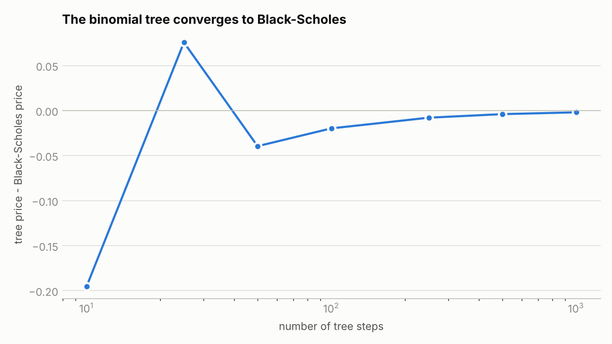
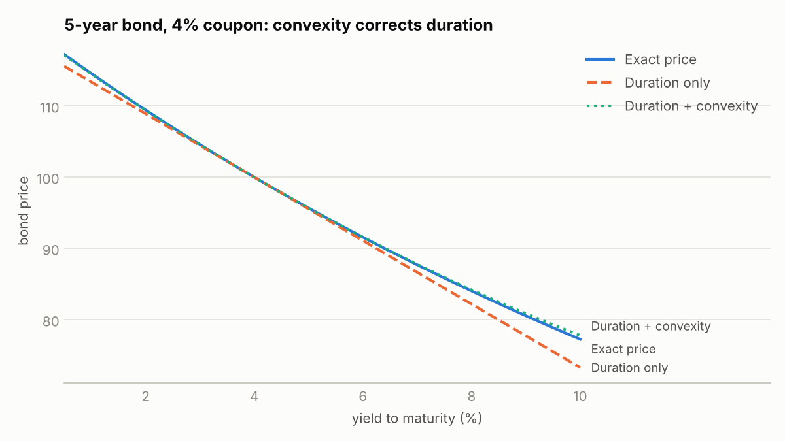
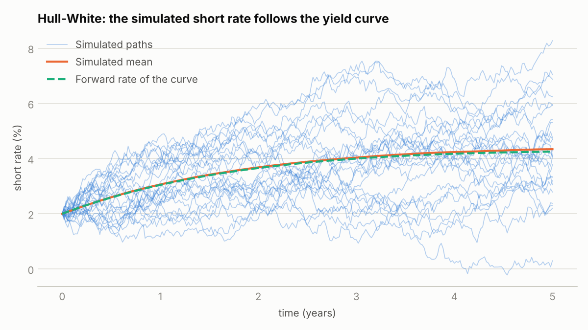

# Derivatives Basics in Python

Personal markets project: implementation of the classic notions from Hull (*Options, Futures and Other Derivatives*), so that they can be tested on real numbers, with unit tests that reproduce the book's examples.

## Contents

| Part | What the code does |
|---|---|
| Options | Black-Scholes-Merton (continuous dividend yield), put-call parity, Greeks (delta, gamma, vega, theta, rho), implied volatility |
| Binomial tree | Cox-Ross-Rubinstein model, European and American options, convergence to Black-Scholes |
| Rates | Bond price, Macaulay and modified duration, convexity, DV01, effect of a change in yields |
| Forwards and futures | Theoretical forward price, number of futures to sell to hedge a portfolio using its beta |
| Hull-White (simple version) | Short-rate model fitted to a yield curve, zero-coupon bond price by formula and by simulation, short-rate paths |

## Installation and usage

```bash
pip install -r requirements.txt
python finance_derives.py           # full demo
python finance_derives.py --plot    # + PNG charts
pytest                              # unit tests
```

## Demo results

At-the-money option: S = 100, K = 100, T = 1 year, r = 3%, volatility 20%.

| Result | Value |
|---|---|
| Black-Scholes call / put | 9.41 / 6.46 |
| Call delta / gamma / vega | 0.599 / 0.019 / 38.67 (i.e. +0.39 for +1 volatility point) |
| Binomial tree with 1,000 steps | 9.411, a difference of 0.002 from Black-Scholes |
| American vs European put | 6.74 vs 6.45: the early-exercise premium is 0.29 |
| American vs European call (no dividend) | Same price: exercising before maturity is never optimal |
| 5-year bond, 4% coupon, 4% yield | Price 100, modified duration 4.45, convexity 25.0 |
| Yields +1% on that bond | Actual change -4.33%, duration alone -4.45%, with convexity -4.33% |
| Index at 8,000, r = 4%, dividend yield 2%, 1 year | Forward price 8,161.6 |
| EUR 5.05M portfolio, beta 1.5, futures at 5,050 points | 150 futures to sell |
| Hull-White, 5-year zero-coupon bond | Curve: 0.83434, simulation: 0.83420 ± 0.00032 |
| Hull-White, short rate in 5 years | Mean 4.34%, standard deviation 1.77%, 0.8% of paths negative |







## The Hull-White model

The short rate follows `dr = (θ(t) − a·r) dt + σ dW`:

- `a` is the speed at which the rate reverts to its level;
- `σ` is the volatility of the short rate;
- `θ(t)` is computed so that the model exactly reprices today's yield curve.

The code starts from an illustrative yield curve (2% at the short end, 4% at the long end), computes `θ(t)`, simulates the short rate step by step and checks that the average zero-coupon bond price matches the one on the curve. The closed-form zero-coupon price formula is also implemented and gives the same result.

## Checks

The tests compare the code against known results:

- put-call parity, and Hull's examples (put at 1.26, vega at 12.1, forward at 8,161, 150 futures);
- Greeks against finite differences, duration and convexity against numerical derivatives;
- implied volatility recovers the volatility that was used to compute the price;
- the American call without dividends is worth the same as the European call;
- the Hull-White model reprices the curve's zero-coupon bonds, both by formula and by simulation.

## Limitations

- Black-Scholes assumes a single volatility per underlying: it ignores the smile and skew seen in the market.
- Duration assumes a parallel shift of the yield curve with a single yield. Coupons are annual.
- The forward price ignores storage costs and market liquidity.
- Hull-White: one factor (all rates move together), constant volatility, Gaussian rates so negative values are possible. The parameters `a` and `σ` are set by hand: in practice they are calibrated on cap or swaption prices. The demo curve is illustrative.
