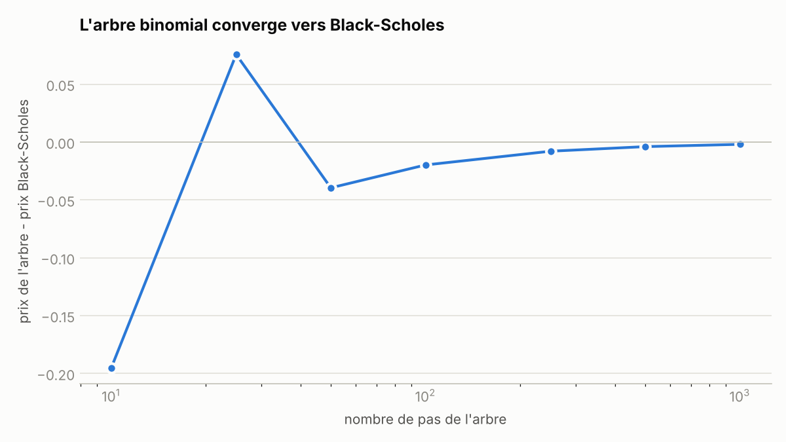
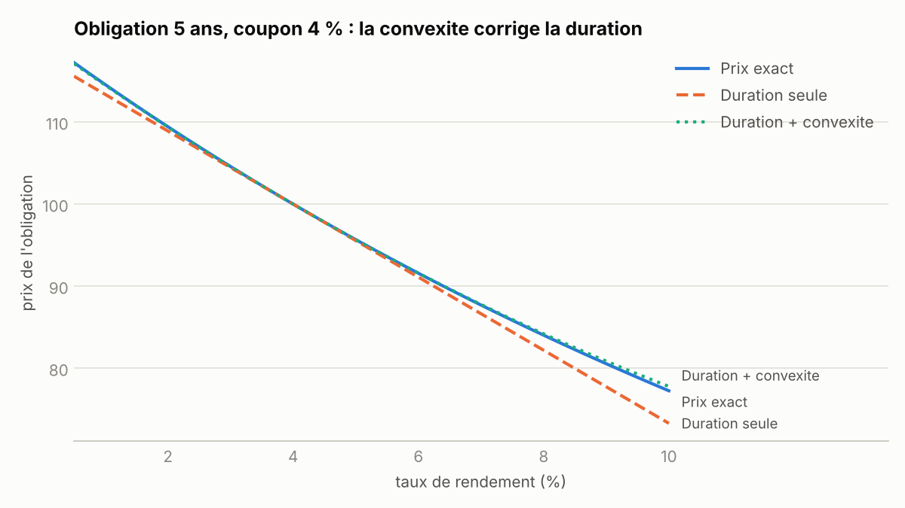
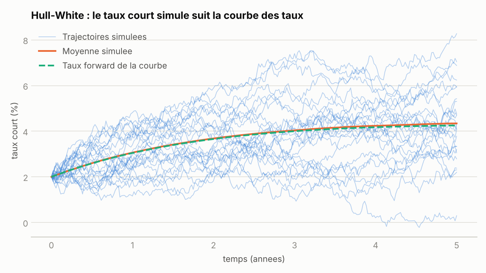

# Les bases des dérivés en Python

Projet perso de finance de marché : implémentation des notions classiques du Hull (*Options, Futures and Other Derivatives*) pour pouvoir les tester sur des chiffres, avec des tests qui reproduisent les exemples du livre.

## Contenu

| Partie | Ce que fait le code |
|---|---|
| Options | Black-Scholes-Merton (avec dividende continu), parité call-put, grecques (delta, gamma, vega, theta, rho), volatilité implicite |
| Arbre binomial | Modèle Cox-Ross-Rubinstein, options européennes et américaines, convergence vers Black-Scholes |
| Taux | Prix d'une obligation, duration de Macaulay et modifiée, convexité, DV01, effet d'une variation de taux |
| Forwards et futures | Prix forward théorique, nombre de futures à vendre pour couvrir un portefeuille avec son bêta |
| Hull-White (version simple) | Modèle du taux court calé sur une courbe des taux, prix d'un zéro-coupon par formule et par simulation, trajectoires du taux court |

## Installation et utilisation

```bash
pip install -r requirements.txt
python finance_derives.py           # démo complète
python finance_derives.py --plot    # + graphiques PNG
pytest                              # tests unitaires
```

## Résultats de la démo

Option à la monnaie : S = 100, K = 100, T = 1 an, r = 3 %, volatilité 20 %.

| Résultat | Valeur |
|---|---|
| Call / put Black-Scholes | 9,41 / 6,46 |
| Delta / gamma / vega du call | 0,599 / 0,019 / 38,67 (soit +0,39 pour +1 point de volatilité) |
| Arbre binomial à 1 000 pas | 9,411, soit un écart de 0,002 avec Black-Scholes |
| Put américain vs européen | 6,74 contre 6,45 : la prime d'exercice anticipé vaut 0,29 |
| Call américain vs européen (sans dividende) | Même prix : exercer avant l'échéance n'est jamais optimal |
| Obligation 5 ans, coupon 4 %, rendement 4 % | Prix 100, duration modifiée 4,45, convexité 25,0 |
| Taux +1 % sur cette obligation | Variation réelle −4,33 %, par la duration seule −4,45 %, avec la convexité −4,33 % |
| Indice à 8 000, r = 4 %, dividende 2 %, 1 an | Prix forward 8 161,6 |
| Portefeuille de 5,05 M€, bêta 1,5, futures à 5 050 points | 150 futures à vendre |
| Hull-White, zéro-coupon 5 ans | Courbe : 0,83434, simulation : 0,83420 ± 0,00032 |
| Hull-White, taux court dans 5 ans | Moyenne 4,34 %, écart-type 1,77 %, 0,8 % de trajectoires négatives |







## Le modèle de Hull-White

Le taux court suit `dr = (θ(t) − a·r) dt + σ dW` :

- `a` est la vitesse à laquelle le taux revient vers son niveau ;
- `σ` est la volatilité du taux court ;
- `θ(t)` est calculé pour que le modèle redonne exactement la courbe des taux d'aujourd'hui.

Le code part d'une courbe des taux illustrative (2 % à court terme, 4 % à long terme), calcule `θ(t)`, simule le taux court pas à pas et vérifie que le prix moyen du zéro-coupon redonne celui de la courbe. La formule fermée du prix d'un zéro-coupon est aussi implémentée et donne le même résultat.

## Vérifications

Les tests comparent le code à des résultats connus :

- la parité call-put, et les exemples du Hull (put à 1,26, vega à 12,1, forward à 8 161, 150 futures) ;
- les grecques contre des différences finies, la duration et la convexité contre des dérivées numériques ;
- la volatilité implicite retrouve la volatilité qui a servi à calculer le prix ;
- le call américain sans dividende vaut le call européen ;
- le modèle de Hull-White redonne le prix des zéro-coupons de la courbe, par la formule et par simulation.

## Limites

- Black-Scholes suppose une seule volatilité par sous-jacent : il ne tient pas compte du smile ni du skew observés sur le marché.
- La duration suppose un déplacement parallèle de la courbe des taux avec un seul rendement. Les coupons sont annuels.
- Le prix forward ne tient pas compte des coûts de stockage ni de la liquidité du marché.
- Hull-White : un seul facteur (tous les taux bougent ensemble), volatilité constante, taux gaussiens donc négatifs possibles. Les paramètres `a` et `σ` sont fixés à la main : en pratique on les calibre sur des prix de caps ou de swaptions. La courbe de la démo est illustrative.
