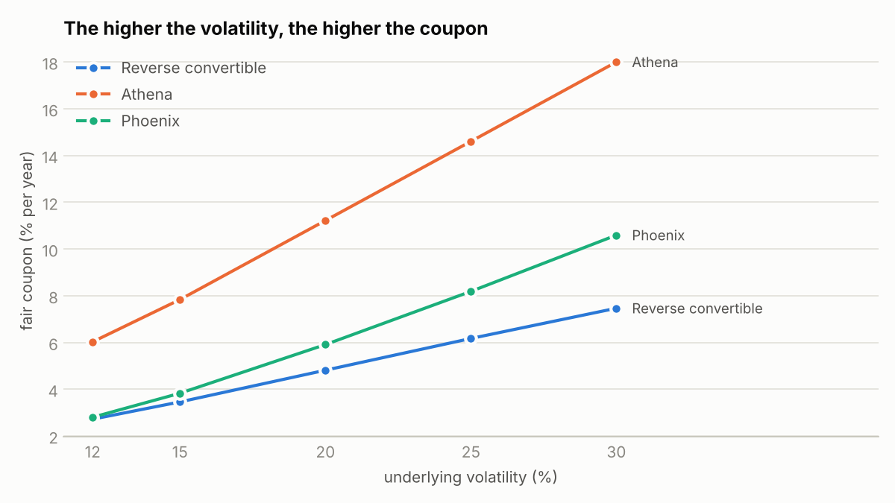
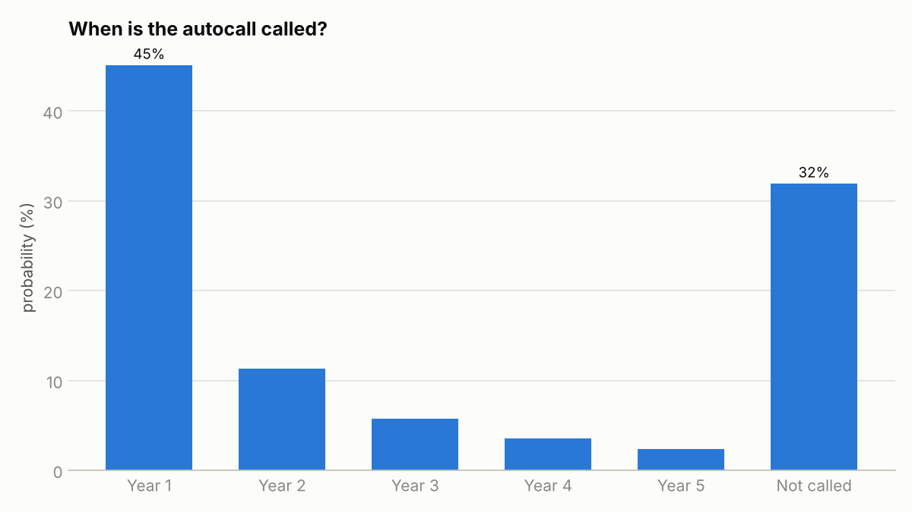

# Equity Structured Products Pricer

Python pricer for structured products on a single equity underlying: capital-protected note, reverse convertible, Athena and Phoenix autocalls. For each product, the code computes the **fair coupon** (or fair participation) for a given structurer's margin, the Greeks, the call probabilities and the risk of capital loss.

## Products

| Product | Payoff | What the investor is really doing |
|---|---|---|
| Capital-protected note | 100 × (protection + participation × rise of the underlying) | Buys a zero-coupon bond and a call with the remaining budget |
| Reverse convertible (70% barrier) | Fixed annual coupon. At maturity: 100 if the underlying is above the barrier, otherwise delivery of shares | Sells a down-and-in put and collects the premium as a coupon |
| Athena autocall | Early call at 100% each year, accumulated coupon paid at the call | Sells a down-and-in put and accepts an early call |
| Phoenix autocall | Like Athena, but a conditional annual coupon (70% barrier) with memory of missed coupons | Same, with a coupon that is a digital option |

## Method

1. Simulate paths of the underlying in the risk-neutral world (it earns the risk-free rate minus the dividend yield on average).
2. Compute the product's payoff on each path.
3. Discount at the risk-free rate.
4. Average: that is the price.

The fair coupon is the one for which the value of the cash flows equals 100 minus the structurer's margin. Since the cash flows are linear in the coupon, two pricings are enough to find it. The Greeks are computed by moving the spot by 1% or the volatility by 1 point, using the same random draws, so that the change in price does not come from simulation noise.

## Installation and usage

```bash
pip install -r requirements.txt
python structured_products.py                       # full demo
python structured_products.py --sigma 0.25 --plot   # other volatility + charts
pytest                                              # unit tests
```

Options: `--r` (rate), `--q` (dividend yield), `--sigma` (volatility), `--margin` (structurer's margin), `--paths` (number of paths).

## Demo results

Assumptions: rate 2.5%, dividend yield 3%, volatility 20%, structurer's margin 1.5% (the cash flows must be worth 98.5 for an issue price of 100).

| Product | Result |
|---|---|
| 5-year capital-protected note | Fair participation in the upside: 71.4% |
| 3-year reverse convertible, 70% barrier | Fair coupon: 4.82% per year, probability of capital loss: 20.7% |
| 5-year Athena, 60% protection | Fair coupon: 11.22% per year, called in year 1 in 45% of cases, average life: 2.7 years |
| 5-year Phoenix, 60% protection | Fair coupon: 5.91% per year, same call and loss probabilities as Athena (14.6%) |

The Athena and Phoenix coupons cannot be compared directly: the Athena coupon is accumulated and only paid at the call.





## How to read the results

- **The coupon is the price of a sold put.** The higher the volatility, the more that put is worth, so the higher the coupon. A higher protection barrier also makes the sold put pricier, so the coupon rises (Athena: 8.8% with a 50% barrier, 14.2% at 80%).
- **Positive delta, negative gamma, negative vega** for the investor: he is exposed to a fall in the underlying and loses when volatility rises, like a put seller. The bank has the opposite position and hedges it.
- **The capital-protected note** is checked against the Black-Scholes closed-form formula (unit test).

## Assumptions and limitations

- Flat volatility: no smile or skew. In practice the 60-70% put is usually worth more than with a flat volatility at the market level, so real coupons may differ.
- Constant rate and dividend yield, a single underlying, annual observation.
- No issuer credit risk or funding cost: the investor actually bears the risk of the issuing bank.
- The structurer's margin is a single parameter, not a real fee model.
- The demo figures come from market assumptions, not from real quotes.

## Possible extensions

Multi-underlying products (worst-of, with correlation), a delta-hedging simulator to see the bank's P&L, a volatility smile.
