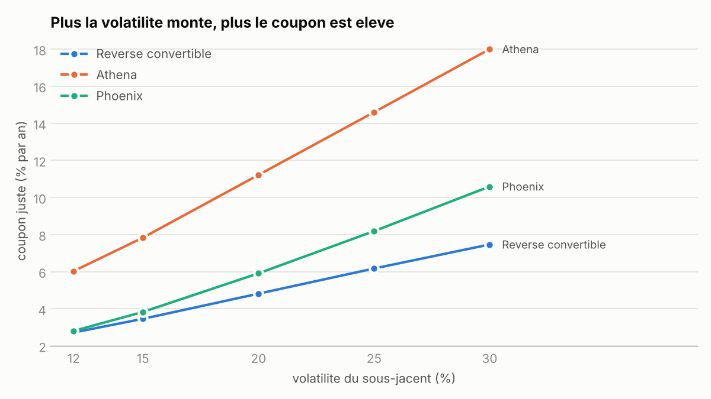
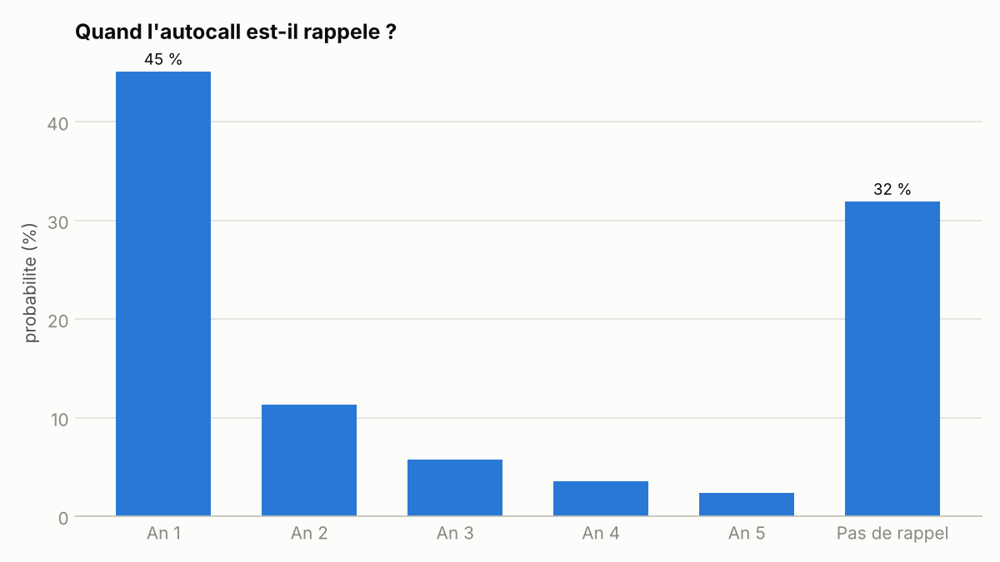

# Pricer de produits structurés actions

Pricer en Python de produits structurés sur un sous-jacent action : note à capital protégé, reverse convertible, autocall Athena et Phoenix. Pour chaque produit, le code calcule le **coupon juste** (ou la participation juste) pour une marge de structureur donnée, les grecques, les probabilités de rappel et le risque de perte en capital.

## Produits

| Produit | Payoff | Ce que l'investisseur fait réellement |
|---|---|---|
| Note à capital protégé | 100 × (protection + participation × hausse du sous-jacent) | Achète un zéro-coupon et un call avec le budget restant |
| Reverse convertible (barrière 70 %) | Coupon fixe annuel. À maturité : 100 si le sous-jacent est au-dessus de la barrière, sinon livraison de titres | Vend un put down-and-in et encaisse la prime sous forme de coupon |
| Autocall Athena | Rappel anticipé à 100 % chaque année, coupon cumulé payé au rappel | Vend un put down-and-in et accepte un rappel anticipé |
| Autocall Phoenix | Comme Athena, mais coupon annuel conditionnel (barrière 70 %) avec mémoire des coupons manqués | Idem, avec un coupon qui est une option digitale |

## Méthode

1. On simule des trajectoires du sous-jacent dans le monde risque-neutre (il rapporte en moyenne le taux sans risque moins le dividende).
2. On calcule le payoff du produit sur chaque trajectoire.
3. On actualise au taux sans risque.
4. On fait la moyenne : c'est le prix.

Le coupon juste est celui pour lequel la valeur des flux est égale à 100 moins la marge du structureur. Comme les flux sont linéaires en le coupon, deux calculs suffisent pour le trouver. Les grecques se calculent en bougeant le spot de 1 % ou la volatilité de 1 point, avec les mêmes tirages aléatoires, pour que la variation du prix ne vienne pas du bruit de simulation.

## Installation et utilisation

```bash
pip install -r requirements.txt
python structured_products.py                       # démo complète
python structured_products.py --sigma 0.25 --plot   # autre volatilité + graphiques
pytest                                              # tests unitaires
```

Options : `--r` (taux), `--q` (dividende), `--sigma` (volatilité), `--margin` (marge du structureur), `--paths` (trajectoires).

## Résultats de la démo

Hypothèses : taux 2,5 %, dividende 3 %, volatilité 20 %, marge du structureur 1,5 % (la valeur des flux doit valoir 98,5 pour un prix d'émission de 100).

| Produit | Résultat |
|---|---|
| Note à capital protégé 5 ans | Participation juste à la hausse : 71,4 % |
| Reverse convertible 3 ans, barrière 70 % | Coupon juste : 4,82 % par an, probabilité de perte en capital : 20,7 % |
| Athena 5 ans, protection 60 % | Coupon juste : 11,22 % par an, rappel dès l'année 1 dans 45 % des cas, durée de vie moyenne : 2,7 ans |
| Phoenix 5 ans, protection 60 % | Coupon juste : 5,91 % par an, mêmes probabilités de rappel et de perte qu'Athena (14,6 %) |

Les coupons d'Athena et de Phoenix ne se comparent pas directement : le coupon d'Athena est cumulé et payé uniquement au rappel.





## Comment lire les résultats

- **Le coupon est le prix d'un put vendu.** Plus la volatilité monte, plus ce put vaut cher, donc plus le coupon est élevé. Une barrière de protection plus haute rend aussi le put plus cher, donc le coupon monte (Athena : 8,8 % avec une barrière à 50 %, 14,2 % à 80 %).
- **Delta positif, gamma négatif, vega négatif** pour l'investisseur : il est exposé à la baisse du sous-jacent et perd quand la volatilité monte, comme un vendeur de put. La banque a la position inverse et la couvre.
- **La note à capital protégé** est vérifiée contre la formule fermée de Black-Scholes (test unitaire).

## Hypothèses et limites

- Volatilité plate : pas de smile ni de skew. En pratique, le put à 60-70 % vaut en général plus cher qu'avec une volatilité plate au niveau du marché, donc les coupons réels peuvent différer.
- Taux et dividende constants, un seul sous-jacent, observation annuelle.
- Pas de risque de crédit de l'émetteur ni de coût de funding : l'investisseur porte en réalité le risque de la banque émettrice.
- La marge du structureur est un paramètre unique, pas un vrai modèle de frais.
- Les chiffres de la démo viennent d'hypothèses de marché, pas de cotations réelles.

## Pistes d'extension

Produit sur plusieurs sous-jacents (worst-of, avec corrélation), simulateur de couverture en delta pour voir le P&L de la banque, smile de volatilité.
